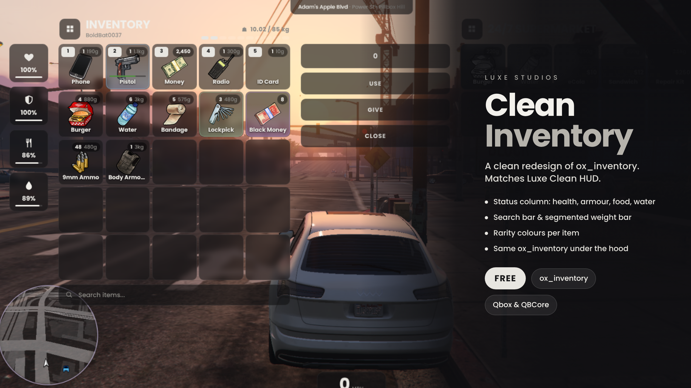

# Luxe Clean Inventory — ox_inventory redesign
**A clean, neutral redesign of the ox_inventory interface** · free · by Luxe Studios · made to match [Luxe Clean HUD](https://luxestudios.shop)

## Features
- **Status column**: health, armour, hunger and thirst next to your inventory
- **Header** with a title and a **segmented weight bar** (amber, then red as you fill up)
- **Search bar**: type and everything that doesn't match fades out
- **Rarity colours**: uncommon, rare, epic and legendary, per item in the config or with `metadata.rarity`
- **Clean slots**: count + weight badge, slot numbers 1-5, item names in normal case, soft glass panels
- Matching amount box, Use / Give / Close buttons, tooltips, right-click menu, hotbar and item pop-ups
- **Matches each player's `/hud` look** when Luxe Clean HUD runs (accent colour, Glass / Solid / None)

Only the interface changes: moving items, shops, stashes and crafting all work exactly like normal ox_inventory.

## Requirements
- **ox_inventory v2.48.1** (the interface is built for this version)
- Qbox or QBCore (for the status column; everything else works on any framework ox_inventory supports)

## Installation
1. Copy **`luxe_cleaninventory`** into your `resources` and add `ensure luxe_cleaninventory` to `server.cfg`.
2. Copy the **`ox_inventory`** folder from this repository over your own `ox_inventory` (it only replaces `web/build`).
3. In **`ox_inventory/fxmanifest.lua`**, under `files { ... }`, add this line after `'web/build/assets/*.css',`:
```lua
    'web/build/assets/*.ttf', -- Luxe Clean Inventory font
```
4. Restart the server.

> Updating ox_inventory overwrites `web/build` and `fxmanifest.lua`: repeat steps 2 and 3 with a build for that version.
> To go back to the original look, restore ox_inventory's own `web/build`.

## Configuration
`luxe_cleaninventory/config.lua`:
| Option | What it does |
|---|---|
| `Config.Accent` | accent colour (slot numbers, weight bar, button hover), used when Luxe Clean HUD isn't running |
| `Config.Background` | `'glass'`, `'solid'` or `'none'` |
| `Config.ShowStatus` | show the health / armour / hunger / thirst column |
| `Config.Rarity` | item name = `'uncommon'`, `'rare'`, `'epic'` or `'legendary'` |

Items can carry their own rarity too: `exports.ox_inventory:AddItem(source, 'goldbar', 1, { rarity = 'legendary' })`.

## Source & license
The interface in `ox_inventory/web/build` is a modified build of [ox_inventory](https://github.com/overextended/ox_inventory) by Overextended, licensed **GPL-3.0** (see `ox_inventory/web/build/LICENSE`). The complete source changes are in `luxe_cleaninventory/source/ox_inventory-v2.48.1-clean-ui.patch`: apply it to ox_inventory v2.48.1's `web` folder, then `npm install` and `npm run build`.

`luxe_cleaninventory` itself is free to use and edit (see `luxe_cleaninventory/LICENSE.md`). Please don't sell or re-upload it as your own.

## Support
[luxestudios.shop](https://luxestudios.shop)
